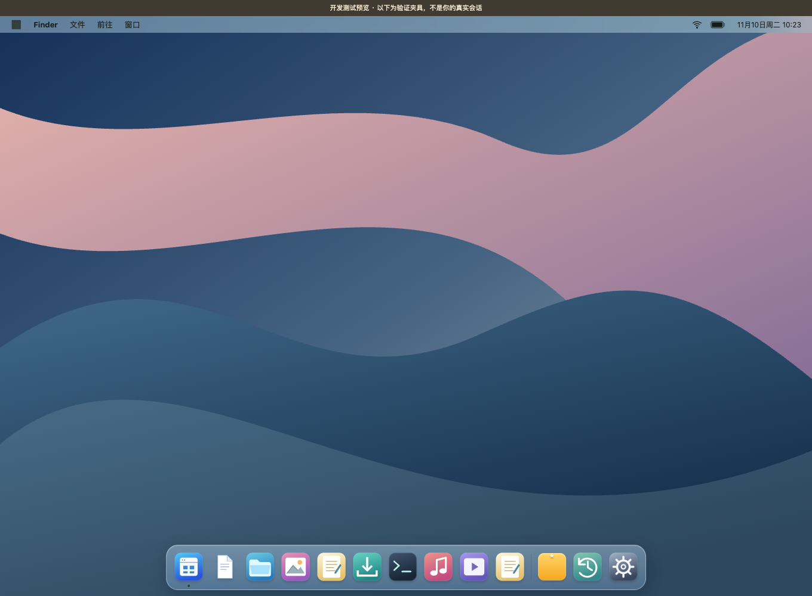

# 成果工作台 · Results Workbench 0.3.1

在 DeepSeek Harness 正常对话、制作作品，回来后从桌面物件查看成果和工作进展。



## 新增：留下判断，再次使用

- **重要成果**：星标、个人备注；独立于会话投影保存，历史重放不会清空。星标不等于备份文件。
- **从旧成果开始**：详情选择“以此为基础”或“按这个做一个”，可选多个来源、当前文件或保存版本，准备页显示实际文件、备注、目标工作区和新要求。点击“开始任务”后创建 Harness 会话并上传完整文件；提交后保存来源关系。浏览不会调用模型。
- **双桌面**：物件桌面与 macOS 风格桌面共享成果、搜索、详情和标记；后者包含菜单栏、真实文件缩略图、Dock、可移动/最大化/最小化的浏览窗口。模式与窗口位置保存在本地。桌面铺满插件面板，外层标题、统计与底部说明已移除；物件桌面的齿轮位于右上角；macOS 桌面的系统设置图标位于 Dock，提供风格切换、成果入口及整理状态。macOS 风格界面保留磨砂 Dock 和 Finder 侧栏；0.3.1 使用项目原创、MIT 许可的壁纸和矢量图标，素材嵌入客户端，无需运行时读取系统目录。Finder 使用非模态窗口，打开时 Dock 仍可用。macOS 桌面不摆放文件图标，成果统一从 Dock 分类进入。
- **保存版本与回顾**：显式保存完整文件副本，按内容 hash 去重，单文件上限 50 MiB。Time Machine 风格、翻书和普通列表共用按月的作品、重要标记、版本及复用记录；支持键盘与减少动画设置。

复用时插件读取并上传副本，不改源文件；任务文字要求使用新文件名。Agent 后续写入仍由 Harness 的工具权限与用户指令约束，这不是文件系统写保护。发送失败会保留目标会话与请求 ID，重试复用同一请求；创建会话结果不明时先提示核对，避免盲目再建。

## 桌面入口

| 物件 | 自动收集的内容 | 查看方式 |
|---|---|---|
| 投影幕 | HTML 演示稿、PPTX、PPT、Keynote 等 | HTML 交互播放；PPTX 简版翻页；其他下载 |
| 电脑 | HTML 网页与应用 | 隔离预览、全屏 |
| 相册 | 图片、设计文件 | 图片浏览 |
| 放映机 | 视频与动画 | 浏览器视频播放器 |
| 音箱 | 音频与音乐 | 浏览器音频播放器 |
| 书架 | Markdown、文本、PDF、Word 等 | 文本/PDF 阅读；其他下载 |
| 资料夹 | CSV、Excel、JSON 等 | 文本数据阅读；其他下载 |
| 工具箱 | 代码和工程文件 | 代码阅读 |
| 笔记本 | 无文件的讨论、有文件工作的讨论摘要 | 每会话最新摘要 |
| 收纳盒 | 暂未识别的其他文件 | 下载或回会话 |
| 便签板 | 进行中、明确的问题和待回答事项 | 查看进展、回原会话 |

分类浏览支持工作主题、状态和关键词搜索。点击作品先预览；“回原会话继续”只导航，不自动向 DeepSeek 发送消息。

## 自动收集与聚合

- 读取 `deliverables/presented` 的真实交付文件。
- 读取成功 `write/edit` 的结果元数据，以 canonical path 定位文件。
- `apply_patch` 只收录结果中明确完成的路径；不把失败或跳过的请求当成成果，移除已删除文件。
- 收集工具结果的图片/文件附件及结构化文件列表。
- 识别助手消息里的本地 Markdown 文件链接，覆盖通过命令生成、再通过链接交付的作品；不把普通 HTTP 研究链接作为本地作品。
- 同会话中按规范化路径或附件 ID 聚合同一件成果，并把 read_image 的路径和保存附件合并，保留首次出现位置和记录次数。保留的是当前文件引用，不是各版本文件内容的备份。
- 没有文件的工作仍保留会话讨论摘要；一场对话的多个成果可以分别出现在不同物件中，均关联同一来源会话。
- 工作主题采用本地规则自动识别，区分编程、数据分析、设计创作、研究、写作、日常讨论；不调用额外模型、不产生分类 token 消耗。成果分类结合扩展名、媒体类型、HTML 内容和当前请求。
- 图片列表按需加载真实缩略图；匿名哈希改为“图片 · 宽 × 高”。原文件优先，404/410 时尝试保存预览，并明确标识；下载保存预览按真实媒体格式命名。原文件被改写后，旧保存预览失效，避免误看旧内容。
- 只读 read 的路径元数据不作为新成果收录；read_image 的图片保留，但不重复生成文件条目。
- 状态结合 `turn/start`、结构化 `turn/end.reason.kind` 和 Harness `userQuestions` 投影。普通自然语言中的隐含追问不保证自动识别。

历史会话首次打开成果工作台时，以两个并发读取其投影。读取不会启动模型任务，也不会自动升级旧会话格式。缺失或需要升级的会话会明确显示，可进入原会话处理。后续会话变化由 Harness 的订阅更新。

## 实现结构

- `model.js`：纯事件折叠、分类、去重；pending 工具状态随投影保存，缓存恢复不会丢失调用关联。
- `index.js`：注册 `desk` summary 投影，`stateVersion: 6`。版本变更使旧缓存重新折叠。
- `client-source.js`、`feature-ui.js`、`desk.css`：两种桌面、共用浏览器、复用准备页与回顾。
- `library-store.js`、`library-routes.js`：持久成果身份、CAS 备注、文件版本、复用记录与认证后的 Host 路由。
- `library-client.js`：文件上传、会话创建和幂等提交；`review-model.js`：按月事实汇总。
- `pptx-preview.js`：本地解压 PPTX，提取幻灯片文字和内嵌图片，不上传文档。
- `scripts/build-client.js`：使用 esbuild 生成独立 `client.js`，内含共享分类规则与必要的 ZIP 读取代码。
- `tests/`：模型、Host 契约和可重复浏览器验证；演示夹具只用于测试预览，不混入真实工作台。

## 安装与发布

已验证宿主：DeepSeek Harness **0.2.2-rc.1**，Node 24，macOS；其他宿主版本与操作系统尚未实机验证。发布名保留 `@local/desk-workbench`，避免改变既有插件身份；展示名称为“成果工作台”。

从公开 Git 仓库安装：

```bash
dsh plugin --profile desktop add github:mimiqiao/DSH-Dock
```

重启 Harness 后，在侧栏打开“成果工作台”。也可在 Web profile 使用同一插件。打包发行文件：

```bash
npm ci
npm run package
```

`dist/dsh-dock-0.3.1.zip` 的根目录包含真实的 package.json、bundle patch、Host/Client JavaScript、元数据和许可证。发布包不含会话数据、node_modules 或本地截图。MIT 许可证与依赖许可见 LICENSE、THIRD_PARTY_NOTICES.md。AI 精选尚未实现。

## 本地开发与验证

```bash
npm ci
npm run build
npm test
npx playwright install chromium   # 新机器首次运行浏览器验证时
npm run preview                  # 独立测试页面，127.0.0.1:43189
npm run test:browser              # 在另一个终端运行
npm run test:features             # 星标、复用、双桌面、版本与回顾
```

测试预览顶部标明“开发测试预览”，其中的数据不是你的真实会话。

本地 desktop profile 若通过符号链接使用此目录，重新打开 Harness 后读取新版；界面如仍使用旧缓存，刷新窗口。其他环境需先将本插件加入 Harness 的插件配置。Host 依赖 Zod 与 Node 内置模块；ZIP 读取库已打进客户端。

## 数据与生态边界

个人数据位于 `${DSH_HOME}/desk-workbench`；未设置 DSH_HOME 时使用 `~/.dsh/desk-workbench`。其中 `library.json` 保存身份、别名、星标、备注、版本索引、复用关系及偏好，`blobs/` 保存按 hash 命名的版本内容。取消星标不删除源文件或已保存副本。

`/api/desk.library`、`/api/desk.version`、`/api/desk.content` 经 Harness 连接认证及 owner 权限检查；版本内容使用 sandbox CSP 与 nosniff。文件和元数据先写临时文件再原子替换；跨进程锁与 revision 避免并发覆盖。

按用户补充的生态说明，本插件定位为个人成果应用：复用 Harness 的会话、上传、执行和权限能力，专注个人判断、成果复用与回顾。macOS 风格是应用内呈现，不接管系统桌面。

## 已知边界

- HTML 在不带 `allow-same-origin` 的 iframe sandbox 内执行，支持自身的按钮与翻页。普通 `src`/`href` 文件资源会按原文件位置解析；动态模块、运行时 fetch、CSS 内嵌相对资源和复杂多文件应用可能受 sandbox/CORS 或路径限制。
- PPTX 是简版预览，显示普通文字、基础填色与内嵌图片；不保证母版、分组、文本换行、图表、字体、动画与 PowerPoint 一致。PPT/Keynote/Word/Excel 等不支持的格式仍可下载原文件。
- 图片、音频、视频及 PDF 的可显示程度受浏览器格式支持影响。浏览器内存与 Harness 文件接口限制同样适用（默认单文件约 50 MiB）。
- 文件已移动或删除时，图片会尝试读取会话保存的预览；同时失效时说明原文件不可用。路径引用不复制文件内容。没有读取通道的非图片附件可回原会话查看。
- 同一文件在不同会话出现时各自保留来源；跨会话不强行合并，以免丢失工作关联。
- 不再限制每会话 12 件成果；大量历史文件会增大会话摘要大小。尚未实现全文索引或任意未知工具的语义识别。文件版本仅从用户显式保存开始，不自动重建过去的内容。
- 界面当前以中文为主；插件入口提供中英文元数据。

- 保存 HTML 是单文件副本，不会自动打包相对引用的图片、字体等资源；讨论保存的是明确标注的当前摘要。复用关系证明来源与任务提交，不表示成果已经被用户认可。

0.3.0 验证与截图见 [验证记录](docs/verification/2026-11-09-v03.md)，设计与验收见 [开发计划](docs/plans/2026-11-09-results-workbench-next.md)。旧版验证见 `docs/verification/2026-11-09.md`。
